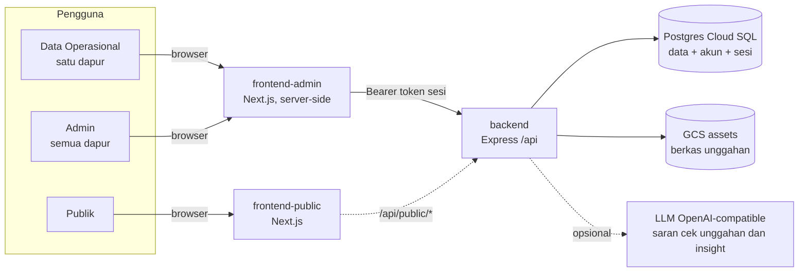
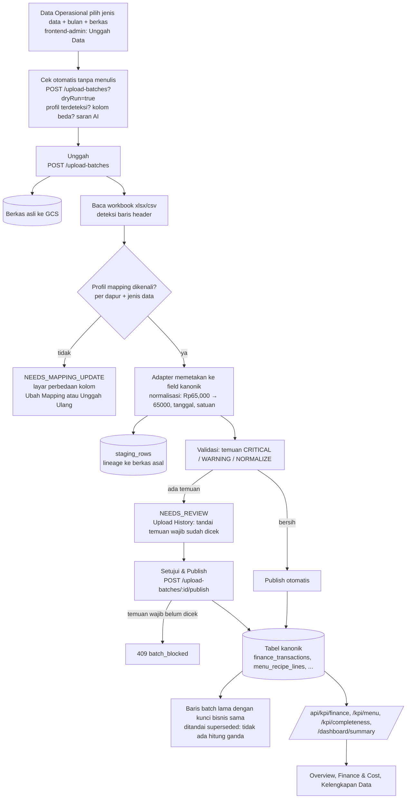
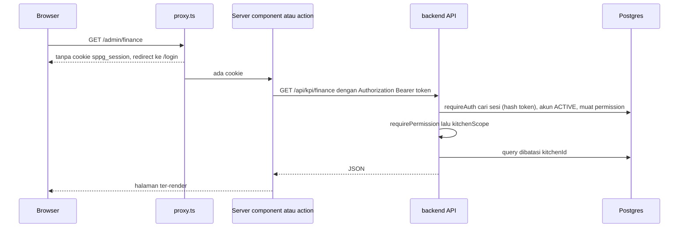
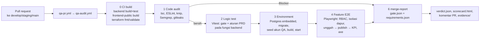

# SPPG Dashboard

Platform program **Makan Bergizi Gratis (MBG)** yang mengkonsolidasikan data
operasional, gizi, dan keuangan dari dapur SPPG. Dapur mengunggah berkas
(cashflow, menu, dan lainnya), sistem membaca dan memvalidasinya, lalu angka
yang sudah di-publish tampil di dashboard.

Monorepo dengan tiga service yang di-deploy terpisah, satu stack infrastruktur,
dan satu service audit mutu (`qa-audit/`) yang hanya berjalan di CI atau laptop.
Konvensinya folder saja: tidak ada npm/pnpm workspace dan tidak ada Turborepo.
Tiap folder punya `package.json` dan lockfile sendiri, dan tiap job CI bekerja di
`working-directory` yang sesuai.

## Isi repo

| Folder | Isi | Stack | Dijalankan di |
|---|---|---|---|
| [`backend/`](backend/README.md) | REST API, auth internal, RBAC, pipeline unggah → publish → KPI | Express, TypeScript, Prisma, Postgres | Cloud Run, `/api/*`, `/health` |
| [`frontend-admin/`](frontend-admin/README.md) | Backoffice + Dashboard Internal (di belakang login) | Next.js 16 (App Router), Tailwind 4 | Cloud Run, `/admin` |
| [`frontend-public/`](frontend-public/README.md) | Dashboard transparansi publik | Next.js (App Router) | Cloud Run, `/` |
| [`infra/`](infra/README.md) | Cloud Run, Cloud SQL, Artifact Registry, GCS, Secret Manager | Terraform, GCP `asia-southeast2` | — |
| [`qa-audit/`](qa-audit/README.md) | Satu verdict "aman di-merge atau tidak" per PR, plus bukti | Playwright, Vitest, Semgrep, gitleaks | CI atau laptop |
| [`projects/jira/`](projects/jira/README.md) | Status tiket SCRUM dan decision log aplikasi | Markdown | — |

Status per 2 Nov 2026: `backend` dan `frontend-admin` sudah berisi produk
(unggah, mapping, validasi, publish, dashboard Finance/Overview, anggota).
`frontend-public` masih satu halaman statis "Segera Hadir" karena desain UI/UX
publik belum selesai; fondasi deployment-nya sudah jalan.

## Gambaran besar



Poin penting:

- **Browser tidak pernah memanggil backend langsung.** frontend-admin meneruskan
  semuanya dari server-nya (`lib/api.ts`, server action) dengan token sesi dari
  cookie `sppg_session` (httpOnly). Penjaga data yang sebenarnya adalah backend,
  bukan menu yang disembunyikan di frontend.
- **Tidak ada layanan identitas eksternal.** Password (argon2id), sesi, MFA TOTP,
  dan role semuanya di Postgres. Detail: [`backend/docs/AUTH.md`](backend/docs/AUTH.md).
- **Halaman publik** membaca lewat `/api/public/*`, yang memakai role database
  `sppg_public` dengan hak terbatas.

## RBAC

Dua role (SCRUM-152). Tidak ada tahap review Admin (SCRUM-148) dan tidak ada role Public/CMS.

| Role | Cakupan dapur | Boleh |
|---|---|---|
| `ADMIN` | Semua dapur | Kelola akun dan role, Data Reference, lihat Upload History (hanya lihat dan Export). **Tidak** mengunggah atau mem-publish |
| `DATA_ADMIN` (Data Operasional) | Satu dapur (`user_kitchen_scopes`); tanpa scope tidak melihat apa pun | Unggah, cek validasi, lalu **Setujui & Publish** sendiri |

Route memeriksa **permission** (`requirePermission('upload:create')`), bukan
nama role. Kalau pemanggil meminta dapur di luar scope-nya, backend menjawab
`403 forbidden_kitchen` ("Anda tidak memiliki akses ke kitchen ini.").

## Flow data: unggah sampai dashboard

Ini alur utama produk. Satu berkas melewati lima tahap; di setiap tahap ada yang
menjaga agar angka salah tidak sampai ke dashboard.



Status batch (`UploadStatus`): `PROCESSING` → `NEEDS_REVIEW` /
`NEEDS_MAPPING_UPDATE` → `PUBLISHED`, atau `FAILED`. `SUPERSEDED` ("Diganti")
untuk berkas lama yang diganti unggah ulang. `PUBLISHED` dan `FAILED` adalah status akhir.

Aturan bisnis yang dijaga di kode (dan dibuktikan oleh qa-audit):

| Aturan | Di mana |
|---|---|
| Data hilang tampil `-`/Missing, bukan 0 | `backend/src/lib/kpi.ts` |
| `transaction_total` yang berulang di tiap baris tidak dijumlah per baris; supplier = Σ `line_amount` | `kpi.ts` |
| Hanya baris `TERKONFIRMASI` dari batch `PUBLISHED` yang dihitung KPI | `lib/publish.ts` (`ELIGIBLE_REVIEW_STATUSES`) |
| Transfer internal (EFI) bukan belanja eksternal dan bukan Top Supplier | `kpi.ts` |
| Unggah ulang atau koreksi tidak menggandakan angka (supersede per kunci bisnis) | `lib/publish.ts` (`SUPERSEDE`) |
| Planned Cost per Portion selalu berlabel Rencana/RAB | `kpi.ts` (`plannedCostPerPortion`) |
| Akun tanpa scope dapur tidak melihat dapur mana pun | `lib/scope.ts` (`kitchenScope`) |

Setiap endpoint yang mengubah data menulis satu baris audit log
(`<tabel>.<peristiwa>`, mis. `upload_batch.published`).

## Flow request: dari browser ke data



Sesi disimpan di tabel `sessions`, bukan JWT, jadi menonaktifkan akun, mengganti
role, atau mencabut sesi berlaku di request berikutnya. Tiga lapis di backend:
`requireAuth` (401), kredensial (401 seragam, lockout, rate limit), dan
otorisasi `requirePermission`/`requireRole` (403).

## Jembatan qa-audit

`qa-audit/` bukan server. Ia menjalankan seluruh aplikasi di runner CI atau
laptop (Postgres embedded, backend, frontend-admin hasil build), menguji dari
luar seperti pengguna, lalu menghasilkan **satu verdict** per PR.



Bagaimana qa-audit terhubung ke tiap bagian:

| Bagian | Cara qa-audit memakainya |
|---|---|
| `backend/` | Dibangun dengan `tsc -p`, dijalankan di `:18080` dengan `NODE_ENV=production`. Seed backend dipakai apa adanya, lalu `seed-qa.ts` menambah akun QA (`admin`, `data-operasional-skn`, `data-operasional-lwg`). Fungsi murni (`kpi.ts`, `values.ts`) diimpor langsung oleh tes Vitest. Fixture cashflow/menu Sukun diambil dari `backend/src/lib/ingest/fixtures/`. |
| `frontend-admin/` | Dibangun dan dijalankan `next start` di `:13000/admin`. Playwright login lewat UI sekali per role, lalu memakai `storageState`. Hasil build juga dipakai ESLint, knip, dan axe. |
| API langsung | `isolasi.spec.ts` memanggil `/api` dengan token sesi untuk membuktikan isolasi dapur (403 `forbidden_kitchen`), 401 tanpa token, dan tidak adanya NIK/telepon/alamat di respons. |
| GCS / email | Dimock di environment QA (GCS tiruan lewat `STORAGE_EMULATOR_HOST`; token reset dibuat seed), jadi izin IAM dan pengiriman email tidak teruji di sini. |
| Persyaratan produk | `requirements.json` memetakan acceptance criteria PRD ke test lewat ID di judul test (`[AC-PUB-01]`, `[SCRUM-151]`). `scorecard.html` menampilkan status tiap requirement. |
| Keputusan merge | Hanya `merge-report` yang membaca `gate.json`. Blocker (tipe, secret, Semgrep keamanan, test smoke/rbac/pii, environment gagal) memerahkan check `qa-audit / audit`. |

Guard: qa-audit menolak target selain localhost atau `QA_STAGING_URL`, jadi tidak
pernah menyentuh production. Panduan lengkap, gate, dan cara menambah test ada di
[`qa-audit/README.md`](qa-audit/README.md).

## Routing

Tiap service adalah Cloud Run service dengan URL `*.run.app` sendiri (HTTPS
bawaan, tanpa load balancer):

```
https://sppg-dashboard-<env>-backend-<nomor project>.asia-southeast2.run.app          /api/*, /health
https://sppg-dashboard-<env>-frontend-admin-<nomor project>.asia-southeast2.run.app   /admin (basePath)
https://sppg-dashboard-<env>-frontend-public-<nomor project>.asia-southeast2.run.app  /
```

frontend-admin memanggil API dari server-nya (`API_BASE_URL`), tidak pernah dari
browser, jadi origin terpisah tidak butuh CORS. `terraform output urls` di
`infra/<env>` menampilkan ketiganya.

## Branch, CI, dan deploy

Hanya `staging` dan `production` yang di-deploy. `develop` adalah branch
transisi: kena gate CI, tidak pernah di-deploy.

```
feature/* ─PR─> develop ─PR─> staging ─PR/tag v*─> main
   fix/*         (CI gate)    (auto deploy)      (deploy + approval manual)
```

Jangan pernah push langsung ke `develop`, `staging`, atau `main`. Satu branch =
satu fitur. Commit singkat dan present tense.

| Pemicu | Workflow | Efek |
|---|---|---|
| PR ke `develop`/`staging`/`main` | `qa-pr.yml` → `qa-audit.yml` | Satu check `qa-audit / audit` (alur di atas). Tanpa kredensial GCP. Sekitar 2,5–4,5 menit. |
| push ke `staging` | `deploy-staging.yml` | Build+push 3 image, migrasi DB (Cloud Run Job), `terraform apply` yang menunggu ketiga service siap. |
| push ke `main` atau tag `v*` | `deploy-prod.yml` | Sama, di belakang approval manual. Frontend belum di-deploy ke production. |
| Terjadwal 21:00 WIB, Senin–Jumat | `sync-staging.yml` | Merge `develop` ke `staging` setelah staging dimatikan malam hari, supaya commit sehari terdeploy sebelum jam kerja berikutnya. |

Deploy staging membangun ketiga image dan menjalankan **satu** `terraform apply`
yang memegang semua image tag sekaligus. Itu sebabnya tidak ada workflow
per-service: apply terpisah akan saling menimpa tag milik service lain kembali
ke `latest`.

Detail infrastruktur GCP, Workload Identity, penghematan biaya staging, dan cara
mematikan AWS lama ada di [`infra/README.md`](infra/README.md).

## Mulai dari nol

Node 22 (backend menuntut `>=20.11`).

```bash
# Aplikasi
cd backend         && npm ci && cp .env.example .env && npx prisma migrate deploy && npm run seed && npm run dev   # :8080
cd frontend-admin  && npm ci && npm run dev     # http://localhost:3000/admin  (root "/" memang 404)
cd frontend-public && npm ci && npm run dev     # http://localhost:3000

# Audit mutu (jalankan npm ci di backend/ dan frontend-admin/ dulu)
cd qa-audit && npm ci && npx playwright install chromium
npm run audit                                   # enam tahap → reports/scorecard.html
```

`backend/.env` wajib diisi (`DATABASE_URL`, `GCS_BUCKET`, `MFA_ENCRYPTION_KEY`;
lihat `backend/.env.example`). frontend-admin hanya membaca `API_BASE_URL`;
frontend-public belum membaca environment variable apa pun.

## Dokumentasi lebih dalam

| Topik | Lokasi |
|---|---|
| Auth, sesi, MFA, audit | [`backend/docs/AUTH.md`](backend/docs/AUTH.md) |
| Permukaan API, guard, scope dapur | [`backend/README.md`](backend/README.md) |
| Tabel dan relasi | `backend/prisma/schema.prisma`, `backend/prisma/README.md` |
| Infra dan biaya | [`infra/README.md`](infra/README.md) |
| Gate, waiver, requirement, arsitektur audit | [`qa-audit/docs/`](qa-audit/docs/) |
| Status tiket, blocker, keputusan | [`projects/jira/`](projects/jira/README.md) |
| PRD | Google Drive (bukan di repo); lihat `qa-audit/docs/tujuan.md` |
