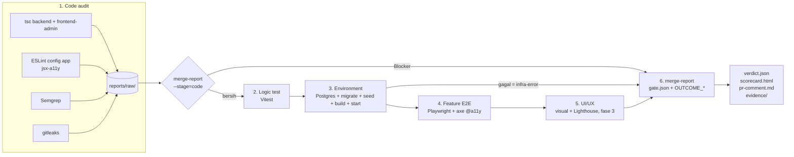

# Arsitektur dan flow



## Komponen
| Berkas | Peran |
|---|---|
| `scripts/audit.ts` | Satu perintah lokal/CI-agnostik: enam tahap berurutan, fail-fast, `env:down` selalu |
| `scripts/code-audit.ts` | Tahap 1, hanya mengumpulkan output tool ke `reports/raw/` |
| `scripts/env.ts` | Tahap 3: `up` (detached, tunggu siap) / `serve` / `down` |
| `scripts/seed-qa.ts` | Akun QA per role + password role `sppg_public` |
| `scripts/guard.ts` | Allowlist host; dipanggil `env.ts` dan `playwright.config.ts` |
| `scripts/merge-report.ts` | Tahap 6: parser raw + gate + output. Satu-satunya pembaca `gate.json` |
| `gate.json` | Severity, ambang, waiver |
| `requirements.json` | Daftar requirement PRD/Jira yang dibuktikan |

## Environment sementara (tahap 3)
```
env.ts up ──spawn detached──> env.ts serve
                                ├─ embedded-postgres 16.14 :15432 (atau QA_DATABASE_URL)
                                ├─ prisma migrate deploy, tsc backend
                                ├─ seeders backend + seed-qa (akun per role, sppg_public)
                                ├─ next build frontend-admin
                                ├─ backend  node dist/src/server.js  :18080 (NODE_ENV=production)
                                └─ frontend next start               :13000/admin
up menunggu /health dan /admin/login → exit 0; gagal/timeout → tail env.log, exit 1
```
Backend berjalan dengan `NODE_ENV=production`, jadi `/api/public/*` memakai role DB `sppg_public`
yang terbatas, sama seperti production. Kunci MFA dan password DB dibuat acak per run.

## Status tahap dan verdict
Di CI tiap tahap adalah step `continue-on-error`; `outcome`-nya dikirim ke merge-report sebagai
`OUTCOME_CODE|LOGIC|ENV|E2E|UI`. Hasil:

| Verdict | Kapan |
|---|---|
| `pass` | Tidak ada Blocker yang tidak di-waive |
| `fail` | Ada Blocker produk |
| `infra-error` | Environment gagal siap, run dibatalkan, atau tool wajib hilang di CI |
